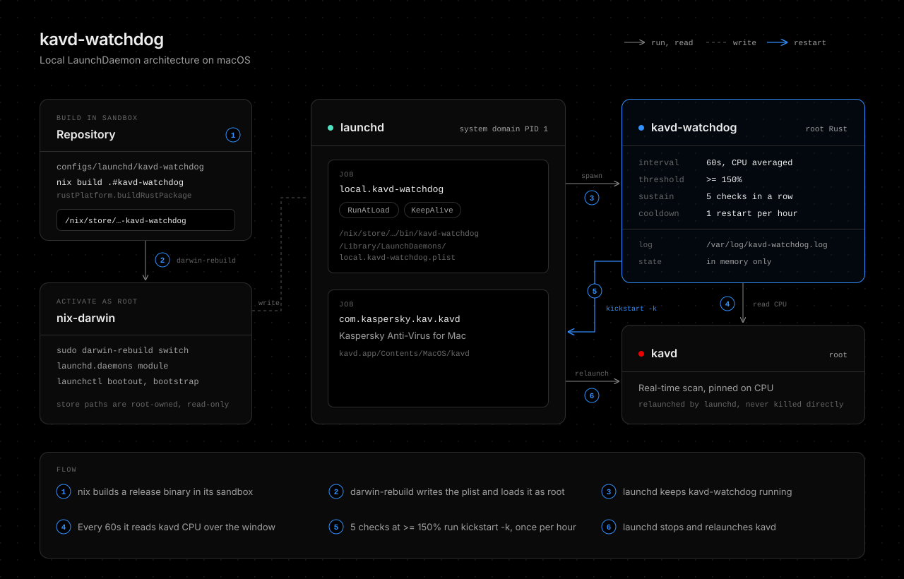

# kavd-watchdog

A Rust LaunchDaemon that restarts the Kaspersky Anti-Virus for Mac daemon (kavd) when it stays pinned on CPU. It is a local tool and is not released.



It stays resident and reads kavd CPU every 60 seconds, averaged over that window. After 5 consecutive checks at or above 150%, it runs `launchctl kickstart -k system/com.kaspersky.kav.kavd`, at most once per hour. This only relieves the symptom. The lasting fix is a scan exclusion for the paths kavd is busy with.

The binary itself is generic: `--service` names the target, and the plist sets it to kavd. Each check asks launchd for the service PID with `launchctl print`, so a look-alike process named kavd cannot trigger a restart.

## Install

nix-darwin installs it with the rest of the system configuration:

```bash
sudo darwin-rebuild switch --flake ~/github/younsl/nix#macbook --impure
```

nix/pkgs/kavd-watchdog.nix builds the binary in the Nix sandbox with the toolchain named by rust-version in Cargo.toml, and nix/darwin/kavd-watchdog.nix declares the LaunchDaemon. The daemon runs the binary from the root-owned, read-only Nix store, never from this user-writable repository, because a root job running a user-writable binary would let any user process run code as root.

Rerun the switch after changing anything here. Removing the import from nix/darwin/default.nix removes the daemon.

| Path | Content |
| --- | --- |
| /nix/store/...-kavd-watchdog-VERSION/bin/kavd-watchdog | Binary |
| /Library/LaunchDaemons/local.kavd-watchdog.plist | LaunchDaemon, with RunAtLoad and KeepAlive |
| /var/log/kavd-watchdog.log | Log of startup, high CPU checks, and restarts |

CPU of a root process reads as 0 unless the watchdog runs as root, so a dry run as yourself only shows `normal` for kavd.

## Options

Each flag falls back to an environment variable, so either ProgramArguments or EnvironmentVariables in the plist works.

| Flag | Variable | Default |
| --- | --- | --- |
| --service | KAVD_WATCHDOG_SERVICE | required |
| --cpu-threshold | KAVD_WATCHDOG_CPU_THRESHOLD | 150 |
| --sustain-checks | KAVD_WATCHDOG_SUSTAIN_CHECKS | 5 |
| --interval-seconds | KAVD_WATCHDOG_INTERVAL_SECONDS | 60 |
| --cooldown-seconds | KAVD_WATCHDOG_COOLDOWN_SECONDS | 3600 |
| --dry-run | KAVD_WATCHDOG_DRY_RUN | false |

`RUST_LOG=debug` also logs every normal check.

Watch live readings as root without restarting anything:

```bash
sudo RUST_LOG=debug "$(nix build ~/github/younsl/nix#kavd-watchdog --no-link --print-out-paths)/bin/kavd-watchdog" \
  --service system/com.kaspersky.kav.kavd --interval-seconds 2 --dry-run
```

## Check

```bash
launchctl print system/local.kavd-watchdog | grep -E "state =|pid =|last exit"
tail -f /var/log/kavd-watchdog.log
```

If Kaspersky self-protection blocks the restart, the log shows `restart failed` with the launchctl error.

## Development

```bash
make lint test
```

## AI Disclosure

The entire codebase of this project was developed with the assistance of [Claude Opus 5.5](https://www.anthropic.com/claude/opus) (High effort).
